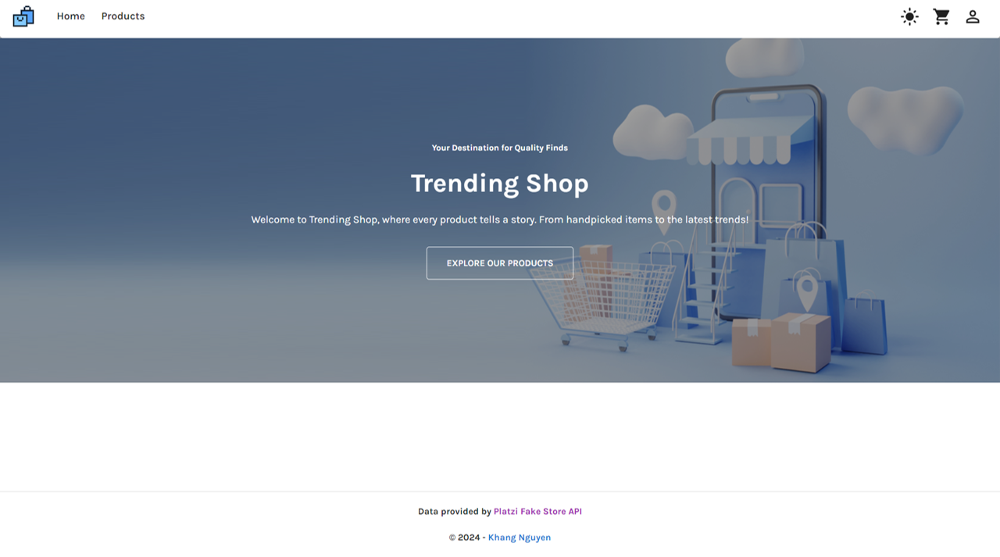
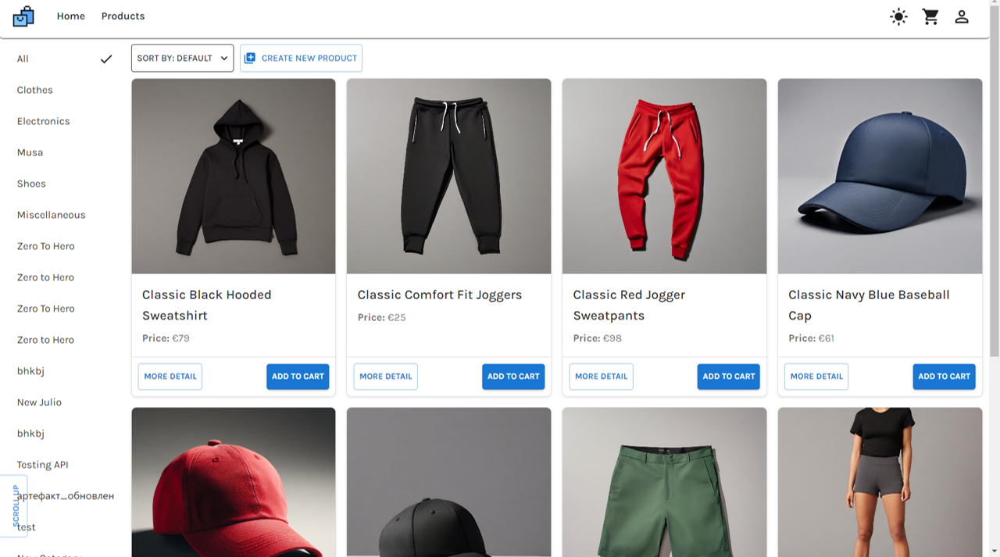
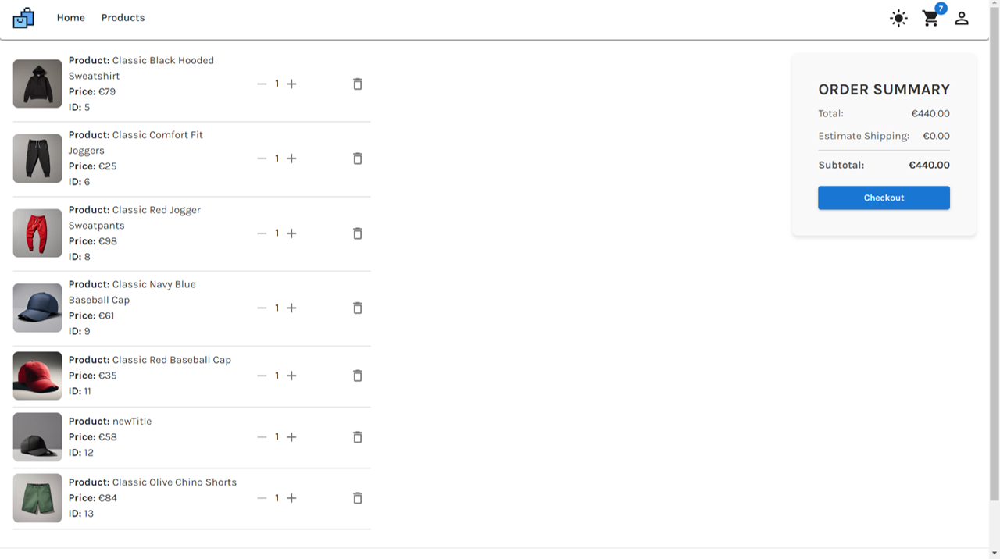
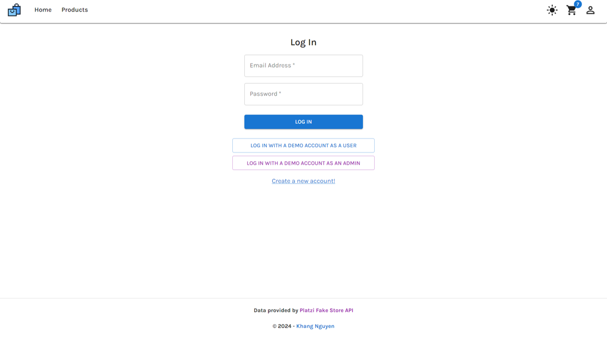
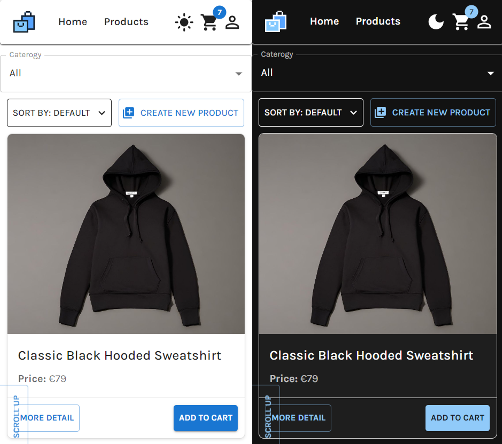

# Trending Shop

Trending Shop is a web application built with React that provides users with an online shopping experience. It fetches product data from [Platzi Fake Store API](https://fakeapi.platzi.com/) and offers features such as browsing products, adding items to the cart, and managing products.

## Table of Contents

1. [Getting Started](#getting-started)
2. [Features](#features)
3. [Technologies Used](#technologies-used)
4. [Project Structure](#project-structure)
5. [Testing](#testing)
6. [Deployment](#deployment)
7. [Screenshots](#screenshots)

## Getting Started

To get started with the Trending Shop project, follow these steps:

### For npm users

1. Clone the repository: `git clone https://github.com/Kudoo39/trending-shop`
2. Navigate to the project directory: `cd trending-shop`
3. Install dependencies: `npm install --legacy-peer-deps`
4. Run the app locally: `npm run start`

### For yarn users

1. Clone the repository: `git clone https://github.com/Kudoo39/trending-shop`
2. Navigate to the project directory: `cd trending-shop`
3. Install dependencies: `yarn install`
4. Run the app locally: `yarn start`

## Features

- **Browse Products:** Explore a diverse selection of products sourced from Platzi Fake Store API.
- **Search Functionality:** Find products quickly by searching with keywords or specific terms, improving navigation and user experience.
- **Product Details:** Access comprehensive information about each product, including name, price, description, and image.
- **Shopping Cart Management:** Add products to the shopping cart and easily manage cart items.
- **User Authentication:** Securely login and register accounts to access personalized features.
- **Demo Account:** Quickly explore the website's features without registering by logging in with a demo account.
- **Light-Dark Mode:** Customize users' browsing experience with the option to switch between light and dark themes.
- **Toast Notifications:** Receive instant feedback on actions or the status of operations through toast notifications.
- **Responsive Design:** Enjoy a seamless shopping experience across various devices with a responsive website design.

## Technologies Used

- TypeScript
- Redux Toolkit
- React
- Material UI

## Project Structure

```
📦
├─ .eslintrc.js
├─ .gitignore
├─ .vscode
│  └─ settings.json
├─ README.md
├─ package.json
├─ public
│  ├─ index.html
│  ├─ robots.txt
│  └─ shop.svg
├─ src
│  ├─ App.tsx
│  ├─ assets
│  │  ├─ icons
│  │  │  └─ shop.svg
│  │  └─ images
│  │     ├─ background.jpg
│  │     ├─ cart_demo.png
│  │     ├─ default_image.jpg
│  │     ├─ homepage_demo.png
│  │     ├─ login_demo.png
│  │     ├─ products_demo.png
│  │     └─ responsive_demo.png
│  ├─ components
│  │  ├─ Categories.tsx
│  │  ├─ Footer.tsx
│  │  ├─ Nav.tsx
│  │  ├─ ScrollUpButton.tsx
│  │  ├─ Search.tsx
│  │  ├─ SortPrice.tsx
│  │  ├─ auth
│  │  │  ├─ DemoAdminAccount.tsx
│  │  │  └─ DemoUserAccount.tsx
│  │  └─ product
│  │     ├─ CreateProduct.tsx
│  │     ├─ DeleteProduct.tsx
│  │     └─ UpdateProduct.tsx
│  ├─ index.css
│  ├─ index.tsx
│  ├─ misc
│  │  └─ type.ts
│  ├─ pages
│  │  ├─ Cart.tsx
│  │  ├─ Home.tsx
│  │  ├─ Login.tsx
│  │  ├─ ProductDetail.tsx
│  │  ├─ Products.tsx
│  │  ├─ Profile.tsx
│  │  └─ Register.tsx
│  ├─ react-app-env.d.ts
│  ├─ redux
│  │  ├─ slices
│  │  │  ├─ cartSlice.ts
│  │  │  ├─ categorySlice.ts
│  │  │  ├─ productSlice.ts
│  │  │  └─ userSlice.ts
│  │  └─ store.ts
│  ├─ reportWebVitals.ts
│  ├─ setupTests.ts
│  ├─ test
│  │  ├─ cart
│  │  │  └─ cartSlice.test.ts
│  │  ├─ category
│  │  │  └─ categorySlice.test.ts
│  │  ├─ product
│  │  │  └─ productSlice.test.ts
│  │  └─ user
│  │     └─ userSlice.test.ts
│  ├─ theme.ts
│  └─ utils
│     ├─ checkImage.ts
│     ├─ cleanImage.ts
│     └─ sort.ts
├─ tsconfig.json
└─ yarn.lock
```

## Testing

### For npm users

1. Ensure all dependencies are installed: `npm install --legacy-peer-deps`
2. Run the test suite: `npm run test`

### For yarn users

1. Ensure all dependencies are installed: `yarn install`
2. Run the test suite: `yarn test`

## Deployment

Check out the [Live Demo](https://trending-shop.netlify.app/) to experience the E-Commerce Website in action.

## Screenshots

Here are some screenshots of the Trending Shop:

**Homepage:**


**Products Page:**


**Cart Page:**


**Login Page:**


**Responsive Design:**

